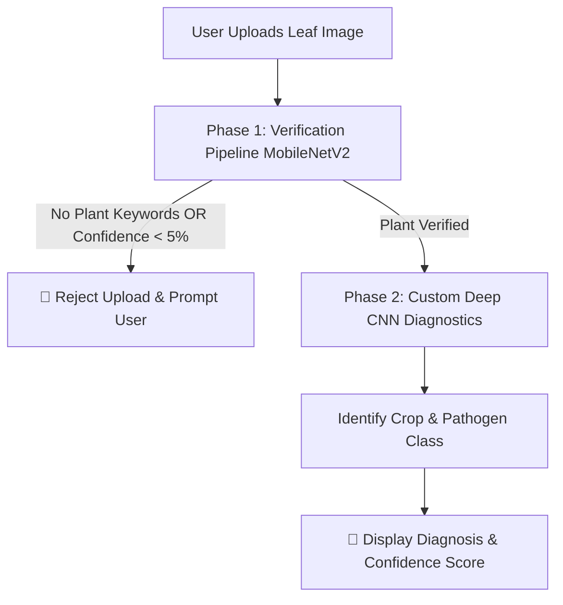

# 🌱 SmartFarming: Precision Agriculture & AI Diagnostics

[](https://www.djangoproject.com/)
[](https://www.tensorflow.org/)
[](https://scikit-learn.org/)
[](https://opensource.org/licenses/MIT)

An intelligent, AI-powered agricultural helper that recommends the most suitable crops for your region based on soil chemistry and weather conditions, and analyzes leaf health to instantly diagnose plant diseases. Built as a fully responsive, enterprise-grade Django web application using dual-stage deep learning pipelines and high-precision ensemble classifiers.

---

## 🚀 Key Platform Capabilities

### 🌾 1. Smart Crop Suitability Recommendation
Analyzes 7 critical environmental and soil parameters to recommend the most optimal crops for agricultural cultivation. Instead of a single guess, it provides the **Top 5 compatible crops** with computed confidence percentages using an ensemble classifier.
* **Chemical Profile**: Nitrogen (N), Phosphorus (P), Potassium (K), and Soil pH levels.
* **Microclimate Factors**: Temperature (°C), Humidity (%), and Rainfall (mm).

### 🍂 2. Dual-Stage Automated Leaf Diagnostics
To prevent false classifications from random uploads (e.g., uploading a picture of a car, human face, or living room), the platform utilizes a advanced **Dual-Stage Diagnostic Pipeline**:



* **Phase 1 (Validation)**: Validates if the uploaded file is indeed a plant leaf using a pre-trained **MobileNetV2** model. If the image doesn't feature plant materials, the system rejects it immediately with a friendly warning.
* **Phase 2 (Diagnostics)**: Processes the verified leaf through a high-accuracy, custom-trained **Deep Convolutional Neural Network (CNN)** (`leaf_disease_model.h5`) trained on the **PlantVillage** dataset, returning the exact disease name along with top-3 alternative predictions and confidence scores.

### 👤 3. Secure User Authentication
* Full user registration, login, logout, and session management.
* Custom middleware and login decorators ensure that diagnostic tools are secure and personalized for individual farmers or researchers.

---

## 🛠️ Technology Stack

* **Web Framework**: Django 6.0.3 (Python 3.10+)
* **Machine Learning**: Scikit-Learn (1.8.0), Joblib (1.5.3)
* **Deep Learning**: TensorFlow (2.20.0), Keras (3.11.3)
* **Image Processing**: Pillow (11.3.0)
* **Database**: SQLite3 (Development)
* **Frontend**: Vanilla CSS Modern UI System (Glassmorphism, custom micro-animations, and leaf texturing backgrounds), FontAwesome Icons, Google Fonts (Poppins & Roboto Slab).

---

## 📁 Repository Structure

```markdown
Smart Farming/
├── .venv/                      # Python virtual environment (git-ignored)
├── accounts/                   # Django App: User registration, login & session views
├── core/                       # Django App: Main landing page, About page, Contact views
├── crop_data/                  # Raw training dataset
│   └── Crop_recommendation.csv # 2200 rows of soil-weather-crop data
├── crops/                      # Django App: Crop suitability recommendation module
│   ├── ml_model.py             # CropModel class (Singleton, loads crop_model.pkl)
│   └── views.py                # Formulation of input parameters & response payload
├── diseases/                   # Django App: Image upload, MobileNet validation & CNN classifier
│   ├── ml_model.py             # DiseaseModel class (Loads custom leaf_disease_model.h5)
│   └── views.py                # Dual-stage verification and detection views
├── model/                      # Serialized ML & Deep Learning models (git-ignored *.h5, *.pkl)
│   ├── confusion_matrix.png    # Validation matrix for the classifier
│   └── feature_importance.png  # Feature importance chart for crop recommendation
├── plant_disease_data/         # Training image datasets (git-ignored)
│   └── PlantVillage/           # Sorted crop leaf directories (Tomato, Potato, Apple, etc.)
├── static/                     # Global static assets (CSS variables, main styles, scripts)
├── templates/                  # Base global layouts
│   └── django_base.html        # Glassmorphic navbar, responsive sidebar, notifications & footer
├── manage.py                   # Django CLI administrative entry point
└── requirements.txt            # Python dependencies lists
```

---

## 📊 AI & Machine Learning Algorithms Breakdown

This platform integrates high-precision machine learning and state-of-the-art computer vision models. Below is a detailed breakdown of which algorithm is performing what kind of work:

### 🌾 A. Crop Suitability Recommendation System
This module uses a highly-optimized ensemble of two machine learning algorithms to analyze 7 soil chemistry and microclimate parameters:
* **Inputs**: Nitrogen (`N`), Phosphorus (`P`), Potassium (`K`), Temperature (`temp`), Humidity (`humidity`), Soil acidity/alkalinity (`ph`), and Rainfall (`rainfall`).
* **Outputs**: Top 5 suitable crop candidates sorted by high probability metrics.

#### 1. Random Forest Classifier
* **Core Job**: Recommends compatible crops based on soil and weather.
* **How it works**: Crop compatibility exhibits highly non-linear boundary relationships (e.g., both drought and excessive flooding cause failure). Random Forest constructs a multitude of decision trees during training and averages their outputs (voting) to make a prediction. This prevents overfitting, manages multi-collinearity among soil elements, and yields stable predictions for the top recommended crops.

#### 2. XGBoost (Extreme Gradient Boosting)
* **Core Job**: Enhances prediction accuracy and generates precise confidence scores.
* **How it works**: It builds decision trees sequentially, where each new tree corrects the errors made by previous ones (gradient boosting). In this system, it complements Random Forest in the ensemble pipeline to deliver extreme stability and pinpoint the exact compatibility percentage for each of the top 5 crop options.

---

### 🍂 B. Leaf Disease Diagnostics System
To guarantee that users do not get high-confidence false-positive results from uploading random images (e.g., a photo of a dog or a car), this system processes inputs through a **Dual-Stage Pipeline**:

#### 3. MobileNetV2 (Phase 1: Verification Layer)
* **Core Job**: Rejects non-plant images and validates leaf uploads.
* **How it works**: Before analyzing leaf health, the uploaded image is passed through MobileNetV2 pre-trained on ImageNet. Using depthwise separable convolutions, it operates at lightning-fast speed with minimal CPU/RAM overhead. It classifies the image and checks its top predicted categories against a vocabulary of 30+ plant-related keywords (e.g., *leaf, plant, flower*). If no keywords are found, the upload is rejected with a warning.

#### 4. Custom Deep Convolutional Neural Network - CNN (Phase 2: Diagnostics Layer)
* **Core Job**: Diagnoses the exact crop type and specific disease/pathogen.
* **How it works**: Once the image passes Phase 1, it is loaded into our custom-trained deep CNN (`leaf_disease_model.h5`) trained on the **PlantVillage** dataset. The model's layers perform automatic visual feature extraction:
  * **Lower layers** identify structural primitives like leaf borders, veins, and light-shadow gradients.
  * **Middle layers** detect local disease textures such as chlorosis, black spot lesions, and powdery mildew.
  * **Deep layers** aggregate these features to predict the exact crop-pathogen class with a robust probability score.

---

### 🔒 C. Core Platform & User Security
#### 5. PBKDF2 with SHA-256
* **Core Job**: Cryptographically hashes and secures farmer/researcher passwords.
* **How it works**: Implemented via Django's secure database middleware (`accounts` app). It uses key stretching to protect sensitive user accounts from brute-force attempts.

---

## ⚙️ Local Installation & Development Setup

Follow these commands to clone the project, install dependencies, and run the server locally on Windows or macOS/Linux:

### 1. Clone the repository & enter the folder
```bash
git clone https://github.com/sushantcaysea/Smartfarming.git
cd "Smart Farming"
```

### 2. Create and Activate Virtual Environment
**On Windows:**
```powershell
python -m venv .venv
.venv\Scripts\activate
```
**On macOS/Linux:**
```bash
python3 -m venv .venv
source .venv/bin/activate
```

### 3. Install Required Dependencies
Make sure you have your virtual environment active, then run:
```bash
pip install -r requirements.txt
```

### 4. Setup Environmental Variables (`.env`)
Create a `.env` file in the root directory:
```env
SECRET_KEY=your-custom-django-secret-key
DEBUG=True
```

### 5. Apply Database Migrations
```bash
python manage.py migrate
```

### 6. Create an Administrative Superuser (Optional)
To access the Django Admin backend (`/admin`):
```bash
python manage.py createsuperuser
```

### 7. Run the Development Server
```bash
python manage.py runserver
```
Visit the platform at `http://127.0.0.1:8000/` in your browser.

### 8. Run Model Training & Compile Files
To train the machine learning classifiers on the crop recommendation dataset and output the serialized model files locally, run:
```bash
python model/train_models.py
```
This will generate and save the model weights to:
* `model/crop_model.pkl` (Random Forest Classifier)
* `model/crop_svm_model.pkl` (Support Vector Machine Classifier)

---

## 📊 Accuracy Verification & Evaluation

You can verify and generate performance reports and confusion matrix images for both subsystems using the following terminal commands:

### 🌾 1. Verify Crop Suitability Model Accuracy
To calculate classification metrics (Precision, Recall, F1-Score) and generate confusion matrix plots for the Random Forest and SVM models, run:
```bash
python model/evaluate_classification.py
```
*   **Console Output:** Prints complete class-by-class classification reports side-by-side in the terminal.
*   **Markdown Report:** Generates a detailed `classification_metrics_report.md` in the project root.
*   **Confusion Matrices:** Saves high-resolution confusion matrix heatmaps in the root directory:
    *   `random_forest_confusion_matrix.png` (Green theme)
    *   `svm_confusion_matrix.png` (Blue theme)

### 🍂 2. Verify Leaf Disease Detection Accuracy (CNN)
To run a live, fast accuracy evaluation of the Convolutional Neural Network model on a random batch of 50 leaf images, run:
```bash
python model/evaluate_disease_accuracy.py
```
*   **Console Output:** Prints a live line-by-line prediction status (`CORRECT`/`INCORRECT`) showing the True Label, Predicted Label, and model confidence, ending with a summary of the batch accuracy.

To generate a high-resolution 15x15 confusion matrix heatmap and a detailed Markdown report for the leaf disease model, run:
```bash
python model/evaluate_disease_classification.py
```
*   **Console Output:** Prints complete class-by-class classification reports side-by-side in the terminal.
*   **Markdown Report:** Generates a detailed `leaf_disease_classification_report.md` in the project root.
*   **Confusion Matrix:** Saves a high-quality heatmap image `leaf_disease_confusion_matrix.png` in the project root directory.

---

## 📌 Model & Data Assets Note
Due to file size limitations on Git, trained model weights (`.h5` and `.pkl` files) and raw image datasets are excluded from version control:
* Make sure `best_model.h5` / `leaf_disease_model.h5` and `crop_model.pkl` are present in the `model/` directory.
* Make sure the `plant_disease_data/PlantVillage/` directory exists containing the folders matching the target classification categories.

---

## 🎨 UI/UX Styling & Theme
The platform features a highly professional, modern agricultural aesthetic:
* **Curated Green Theme**: Utilizes HSL-tailored variables (`--primary-green: #3a7d44`, `--secondary-green: #6bbd46`, `--soil-brown: #8d6e63`).
* **Micro-Animations**: Hover animations on form fields, cards, and navigation buttons.
* **Responsive Layouts**: Designed mobile-first using pure CSS flexbox and grid layouts, fitting perfectly from smart phones to large desktop screens.

---

## 🤝 Contributing & License
Contributions to improve prediction models, UI features, or weather API integrations are welcome! Distributed under the **MIT License**.
