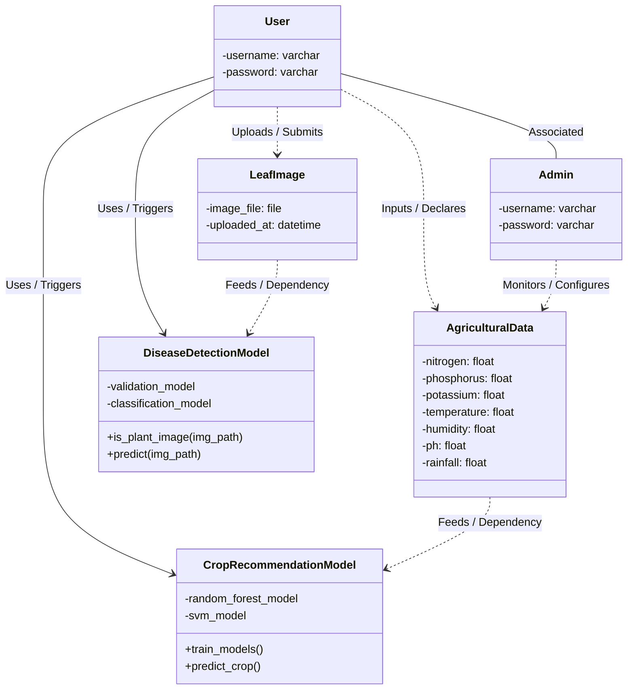

# UML Class Diagram Specification: Smart Farming Decision Support System

This document outlines the **complete UML Class Diagram** for the **Smart Farming Decision Support System**. It integrates both core functional pipelines: **Crop Suitability Recommendation** (using Random Forest & SVM) and **Plant Leaf Disease Diagnostics** (using Custom CNN & MobileNetV2 verification).

---

## 1. Visual Class Diagram (Complete Full-System Architecture)

Below is the custom-generated UML Class Diagram mapping out the complete authentication, crop recommendation, and plant disease pathology database structures:

---

## 2. Interactive & Editable UML Diagram (Mermaid)

The following class diagram is generated using Mermaid. You can edit this directly in your markdown viewer to add or refine attributes and methods.

---

## 3. Structural Class Mapping

This table outlines every class defined in your Smart Farming platform, linking their database parameters, operations, and models:

| Class Name | Attributes / Fields | Key Operations / Methods | Architectural Role |
| :--- | :--- | :--- | :--- |
| **`User`** | `- username: varchar` `- password: varchar` | *Standard Django Auth* | Encapsulates the credentials of the end-user (Farmer) to authenticate sessions. |
| **`Admin`** | `- username: varchar` `- password: varchar` | *Elevated staff privileges* | Holds administrative control for system maintenance and model auditing. |
| **`AgriculturalData`** | `- nitrogen: float` `- phosphorus: float` `- potassium: float` `- temperature: float` `- humidity: float` `- ph: float` `- rainfall: float` | N/A | Represents the physical inputs supplied by the Farmer for crop suitability matching. |
| **`CropRecommendationModel`** | `- random_forest_model` `- svm_model` | `+ train_models()` `+ predict_crop()` | The machine learning wrapper handling ensemble (RF) and kernel maximum-margin (SVM) predictions. |
| **`LeafImage`** | `- image_file: file` `- uploaded_at: datetime` | N/A | Represents the visual input (jpeg/png leaf photo) uploaded by the Farmer for disease detection. |
| **`DiseaseDetectionModel`** | `- validation_model` `- classification_model` | `+ is_plant_image(img_path)` `+ predict(img_path)` | The deep-learning wrapper handling MobileNetV2 verification and Custom CNN disease classification (38 classes). |

---

## 4. Key Relationships & Dependencies

1. **Authentication Layer (`solid line`)**: `User` and `Admin` classes share database associations for permission checking and profiling.
2. **Crop Suitability Pipeline (`dashed arrows`)**:
   * `User` declares `AgriculturalData`.
   * `AgriculturalData` feeds into `CropRecommendationModel` to perform multi-parameter classification.
3. **Leaf Disease Pathology Pipeline (`dashed arrows`)**:
   * `User` uploads a `LeafImage`.
   * `LeafImage` feeds into `DiseaseDetectionModel` which first executes **MobileNetV2** (OOD verification) and then processes the image through the custom **CNN** classifier.
4. **Active Inference Triggers (`solid arrows`)**:
   * `User` executes and queries both the `CropRecommendationModel` and the `DiseaseDetectionModel` to fetch diagnostic reports.
