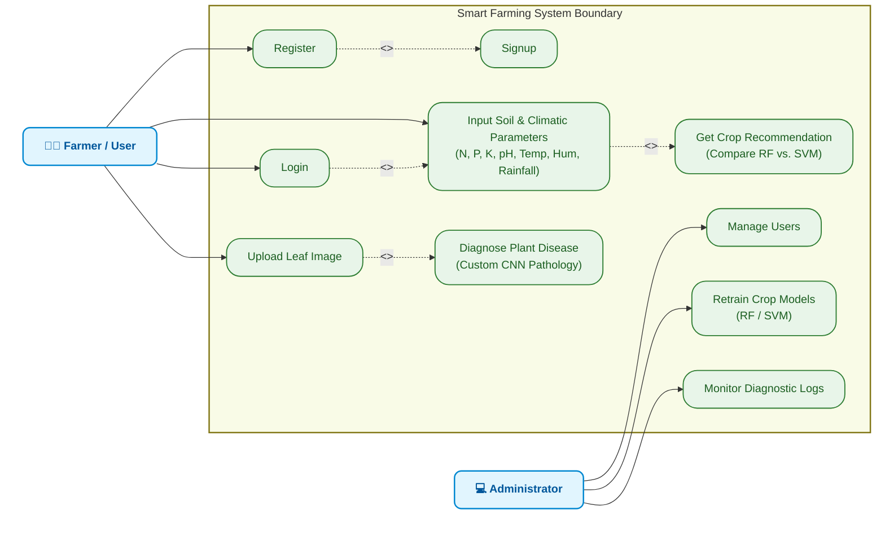

# Use Case Diagram Specification: Smart Farming Decision Support System

This document outlines the **UML Use Case Diagram** for the **Smart Farming Decision Support System**. It highlights the system boundary, the two main actors (Farmer/User and Administrator), and the core use cases including precision crop recommendations (via RF & SVM) and computer vision leaf diagnostics.

---

## 1. Visual Use Case Diagram

Below is the custom-generated visual Use Case Diagram designed for your Smart Farming system:

---

## 2. Interactive & Editable UML Diagram (Mermaid)

The following diagram is generated using Mermaid. It offers a live, interactive, color-coded view of the relationships, including system boundaries, actors, and specific dependencies.

---

## 3. Structural Comparison & Mapping

Below is a tabular mapping comparing your baseline "House Price Prediction System" with the new **"Smart Farming Decision Support System"**:

| Component | House Price Prediction System | Smart Farming Decision Support System |
| :--- | :--- | :--- |
| **Primary Actor** | User | **Farmer / User** (End-user seeking agricultural guidance) |
| **Secondary Actor**| Admin | **Administrator** (Manages users, monitors logs, updates weights) |
| **Core Inputs** | Location, Size, Amenities | **Soil Properties** (N, P, K, pH) & **Climatic Parameters** (Temp, Humidity, Rainfall) |
| **Key Use Cases** | `Input values`, `Prediction` | `Input Soil & Climatic Parameters`, `Get Crop Recommendation` (RF/SVM dual compare), `Upload Leaf Image` |
| **Specialized Extensions**| N/A | `Diagnose Plant Disease` (via deep-learning CNN leaf pathology) |
| **Admin Operations** | `Manage Users`, `Retrain Model`, `Monitor Predictions` | `Manage Users`, `Retrain Recommendation Models`, `Monitor Diagnostic Logs` |

---

## 4. Key Relationships & Rationale

* **`Register` extends `Signup`**: Enables basic sign-up and authentication procedures.
* **`Login` includes `Input Parameters`**: Accessing recommendations requires a logged-in session, ensuring profile history and farm diagnostics are linked to the correct user.
* **`Input Parameters` includes `Get Crop Recommendation`**: Once soil and microclimatic parameters are logged, the system feeds these directly into the dual-stage **Random Forest** and **Support Vector Machine (SVM)** inference pipelines to generate top-5 recommendations.
* **`Upload Leaf Image` includes `Diagnose Plant Disease`**: Dragging/dropping leaf samples triggers the deep-learning backend to run standard ImageNet verification (MobileNetV2) and output diagnostic classifications.
